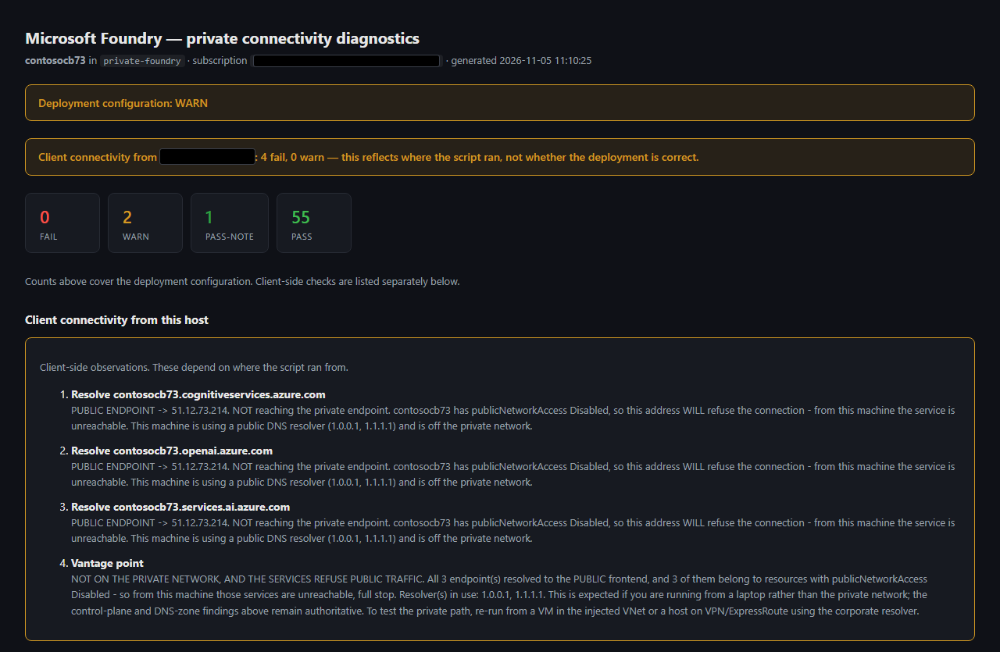
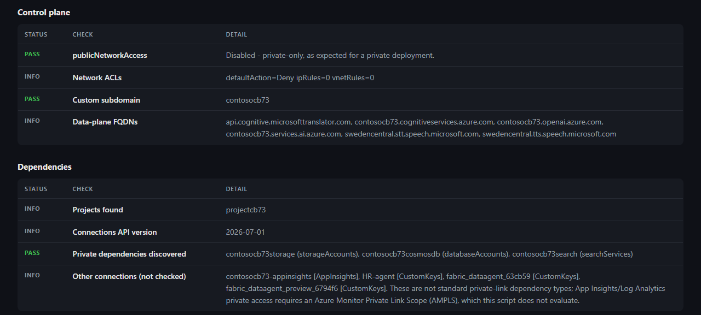
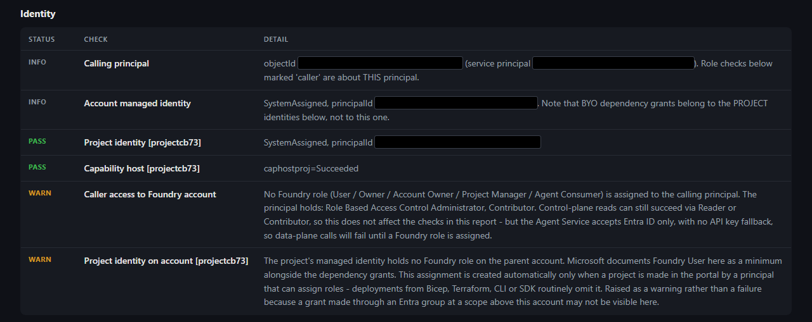
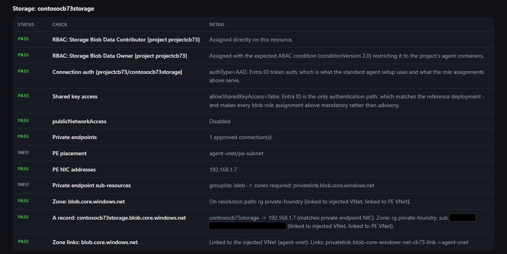
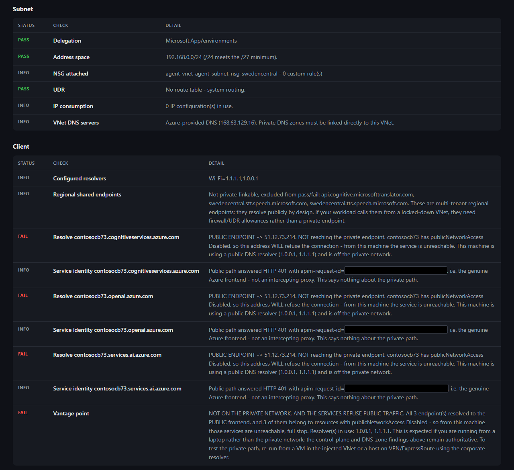

# Foundry Private Connectivity Diagnostic

A read-only PowerShell diagnostic for privately deployed **Microsoft Foundry** (Azure AI Foundry) accounts and their private dependencies (Storage, Cosmos DB, AI Search, Key Vault).

It checks both:

- **Network** – is the topology right (delegated subnet vs. managed network), is public network access disabled, are the private endpoints approved, do the private DNS A records match the endpoints' NIC IPs, which VNets are the zones linked to, and is the subnet healthy (NSG, UDR, service endpoints)? It also runs DNS and TCP tests from the machine you run it on.
- **Authorization** – does each project's managed identity have the role assignments it needs on each dependency? It also checks ABAC conditions, Cosmos DB data-plane RBAC, local-auth settings, and the caller's Foundry roles.

It never changes anything in Azure, and it never reads keys or secrets.

## Quick start

Requires PowerShell 7+ and the Azure CLI. The caller needs **Reader** on the relevant scopes.

```powershell
.\Test-FoundryPrivateConnectivity.ps1 -ResourceGroup rg-ai -AccountName my-foundry

# With a hub VNet (recommended when private DNS is centralized)
.\Test-FoundryPrivateConnectivity.ps1 -ResourceGroup rg-ai -AccountName my-foundry `
    -HubVNetId "/subscriptions/<sub>/resourceGroups/rg-hub/providers/Microsoft.Network/virtualNetworks/vnet-hub"

# Control-plane only, HTML report
.\Test-FoundryPrivateConnectivity.ps1 -ResourceGroup rg-ai -AccountName my-foundry `
    -SkipClientTests -HtmlPath .\foundry-report.html
```

| Parameter | Purpose |
|---|---|
| `-ResourceGroup`, `-AccountName` | The Foundry account to check (required) |
| `-SubscriptionId` | Defaults to the current `az` subscription |
| `-HubVNetId` | Your DNS hub VNet. Zones linked to it count as being on the resolution path |
| `-SkipClientTests` | Skip the DNS and TCP tests from this machine |
| `-ShowAllZones` | List bystander private DNS zones (see below) |
| `-Detailed` | Show full detail text without truncation |
| `-ExportHtml` / `-HtmlPath` | Write a self-contained HTML report |

The exit code is `1` if any deployment-level check fails, otherwise `0`.

## Reading the HTML report

The report follows your OS light/dark preference. The screenshots below are in dark mode, from a private deployment run outside the private network. Identifiers are redacted with black boxes.

### 1. Start at the top: verdict and counters



- **Deployment configuration** is the verdict for the Azure setup itself (PASS, WARN, or FAIL). It drives the script's exit code.
- The **counters** (Fail, Warn, Pass-note, Pass) cover deployment checks only.
- **Fix these first** appears when deployment checks fail. It lists them in priority order.
- **Client connectivity from this host** is shown separately. It describes where you ran the script, not whether the deployment is correct. Here, a laptop outside the VNet resolved the public endpoint, which is expected when public network access is disabled. Re-run from inside the private network to validate the data path.

Below the summary, one table per area follows, in the order the script discovered them. Each row has a **Status**, a **Check**, and **Detail**. Statuses are `PASS`, `PASS-NOTE`, `WARN`, `FAIL`, `INFO`, and `SKIP`.

### 2. Network topology and control plane



The **Control plane** and **Dependencies** tables show the account's network posture (public network access, injected subnet or managed network) and which Storage, Cosmos DB, AI Search, and Key Vault resources were discovered.

### 3. Authorization



The **Identity** table shows the caller's Foundry roles and each project managed identity. Role assignments, ABAC conditions, and local-auth settings per dependency are reported alongside the network checks.

### 4. Per-dependency private endpoint and DNS checks



Each dependency (Storage, Cosmos DB, AI Search, and so on) gets its own table with the same sequence of checks:

1. `publicNetworkAccess` and private endpoint approval.
2. Private endpoint placement and NIC IPs.
3. **Zone** — whether a private DNS zone is *on the resolution path* (see the next section).
4. **A record** — whether the record matches the private endpoint's NIC IP.
5. **Zone links** — which VNets the zone is linked to.

### 5. Subnet health and client tests



The **Subnet** table covers delegation, address space, NSG, UDR, and DNS settings for the injected subnet. The **Client** table shows DNS and TCP results from the machine that ran the script. Skip it with `-SkipClientTests`.

## Private DNS zone selection (v3)

The same `privatelink.*` zone name often exists many times across a tenant. A client only resolves through the zone linked to the VNet whose DNS it uses. The script therefore sorts every zone into one of two groups before checking it:

- **On path:** the private endpoint's DNS zone group points to it, or it is linked to the injected VNet, the `-HubVNetId` VNet, or the private endpoint's own VNet. These zones get A-record PASS/FAIL results.
- **Bystander:** same name, but not linked to any of those. These are not scored; they're counted in one line, and `-ShowAllZones` lists them.

If no zone is on the path, the script reports where a correct record does exist (WARN) or that none exists (FAIL). Two on-path zones that return different IPs are flagged as **split-brain**.

In the report, the `Zone:` row for each dependency tells you which group applies, and the `A record:` and `Zone links:` rows beneath it show the evidence (see [the Storage example above](#4-per-dependency-private-endpoint-and-dns-checks)).

See [`Test-FoundryPrivateConnectivity-README.txt`](Test-FoundryPrivateConnectivity-README.txt) for full documentation, including least-privilege permissions, what each check means, and common findings.

## Disclaimer

This is a community sample. It is not an official Microsoft product and is not supported by Microsoft. Provided as-is under the [MIT License](LICENSE).
